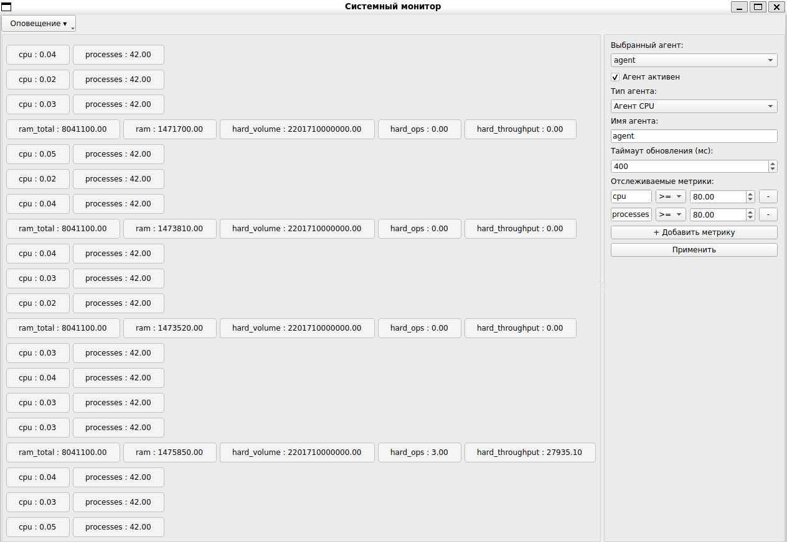

# Monitoring-System
Программа для простого мониторинга основных показателей системы в виде ядра и агентов.



### Используемые библиотеки
- Qt6 - создание кроссплатформенного приложения
- [cpr](https://github.com/libcpr/cpr.git) - работа с HTTP-запросами
- [nhlomann](https://github.com/nlohmann/json) - работа с JSON
- Doxygen - создание удобной документации

## Сборка и запуск

Установка необходимых инструментов
```shell
sudo apt install g++ cmake ninja doxygen
```

Для начала, необходимо скопировать данный репозиторий в систему:
```shell
git clone https://github.com/TarasovaAlina/Monitoring-System.git
```

После собрать проект
```shell
cmake -S .
```

И скомпилировать программу
```shell
make SystemMonitoring
```

Для работы программы потребуется динамическая библиотека агента, который будет заниматься сбором данных. 
Чтобы его создать, используется цель 'agent':
```shell
make agent
```

Запуск программы:
```shell
./bin/SystemMonitoring
```

## Управление конфигами
Для конфигурации работы программы используются JSON файлы с настройками, расположенными в `./config/`. 

### Конфигурация агентов
Расположена в `./config/config.json`

Описание настроек агентов:
```json
{
  <name_agent>: {
    "type": <type_agent>,
    "update_interval": <update_timeout_ms>,
    "critical_metrics": {
      <name_metric_1>: {
        "operator": <operation>,
        "value": <value>
      },
      <name_metric_2>: {
        "operator": <operation>,
        "value": <value>
      }, ...
    }
  }, ...
}
```

- Поддерживаемые операции для метрик: `>, <, >=, <=, ==`
- Доступные типы для агентов: `"CPU_AGENT", "MEMORY_AGENT", "NETWORK_AGENT"`
- "update_interval": целочисленное значение
- "value": неотрицательное значение с плавающей запятой

**Важно! Имена агентов связаны с директорией `./agents/`: 
для каждого указанного в конфигурационном файле агента должен сушествовать файл динамической библиотеки `lib<agent_name>.so`**
Т.е, если в файле `./config/config.json` указан агент с именем "agent", то в `./agents/` должен быть файл `libagent.so`

### Конфигурация сервиса оповещения
Расположен в `./config/notification.json`

Описывает доступ к Telegram боту и сервису отправки Email, 
через которые программа будет осущствлять отправку оповещений пользователю
```json
{
    "telegram": {
        "token": "YOUR_BOT_TOKEN_HERE",
        "id": "YOUR_CHAT_ID_HERE"
    },
    "email": {
        "url": "gmail.com",
        "sender": "your-bot@gmail.com",
        "recipient": "user@example.com",
        "password": "YOUR_APP_PASSWORD_HERE"
    }
}
```

**Важно! Для того, чтобы бот мог отправлять вам сообщения, необходимо запустить его 
(нажать кнопку старт или отправить `/start`)**

- "token": Указывается токен бота (можно создать через @BotFather в Telegram)
- "id": ваш ID, через который бот поймет, кому именно нужно отправлять сообщение (можно узнать через @userinfobot в Telegram)

Для "email";
- "url": адрес почтового сервиса, через который будет производится отправка писем (то, что идет после '@' в названии почты)
- "sender": электронная почта, через которую будет отправлятся письма
- "recipient": на какую почту следует отправлять письма
- "password": специальный пароль приложения (создается в настройках почтового клиента)